# Active Directory Management Studio
### Enterprise Directory Management, Softerra LDAP & NetTools Diagnostics Suite

A modern, high-performance administration workbench built with **PowerShell & WPF/XAML** for managing Microsoft Active Directory and LDAP environments. Engineered for Systems Administrators, Security Engineers, and Directory Operators who require both daily standard administration and advanced low-level directory tooling.


[](HANDBOOK.md)
[](WALKTHROUGH.md)
[](https://github.com/catmuf/ad-management-studio/wiki)

---

## 🖥️ Overview & Hero Presentation

Active Directory Management Studio combines the speed and responsiveness of native Windows desktop applications with the forensic depth of tools like **Softerra LDAP Administrator**, **Apache Directory Studio**, and **NetTools**. Featuring a native 11-category Windows horizontal menu bar, an omnibar quick-search launcher (`Ctrl+K`), tabbed workspace navigation, and 24 specialized administrative workspaces.

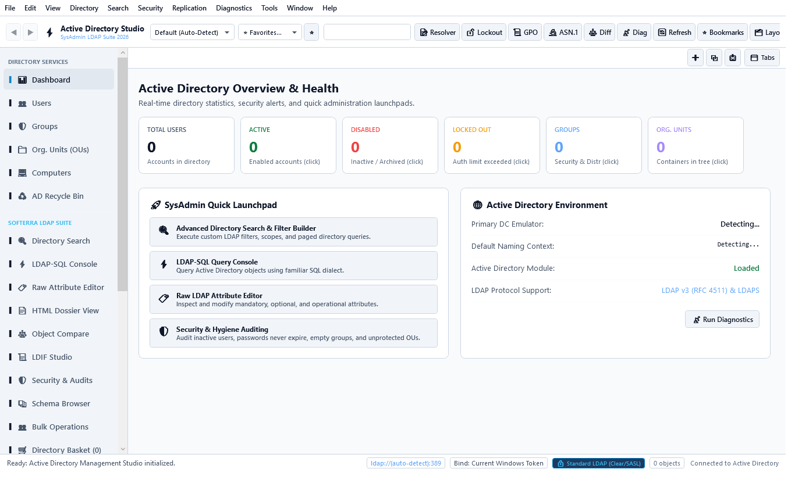

---

## ⚡ Visual Demonstration Galleries

### Gallery 1: Directory Lifecycle Administration & Visual Dossiers

Comprehensive lifecycle management for users, security groups, organizational units, and computers, accompanied by responsive in-app HTML technical dossiers and instant omnibar discovery.

| View / Component | Visual Showcase | Technical Highlights |
| :--- | :--- | :--- |
| **Central Users Management & Attribute Inspector** | 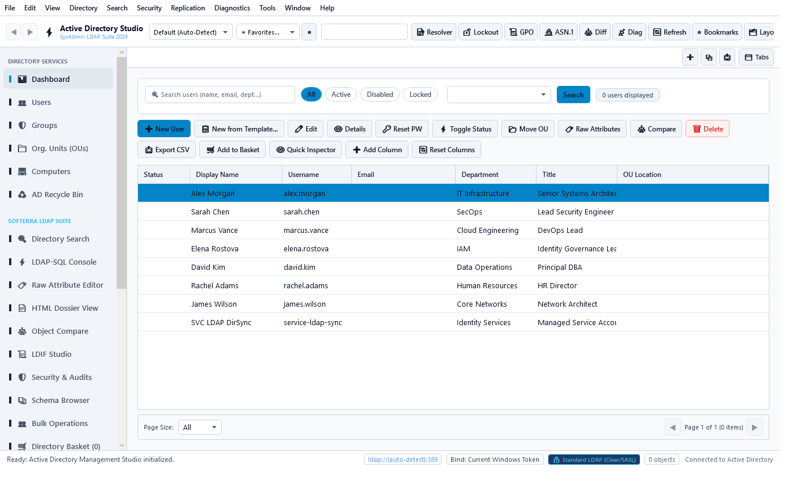 | High-speed virtualized DataGrid with real-time status filtering (All, Active, Disabled, Locked), instant column sorting, and a 2-column inline Attribute Inspector displaying raw LDAP attributes. |
| **In-App HTML Technical Dossier** | 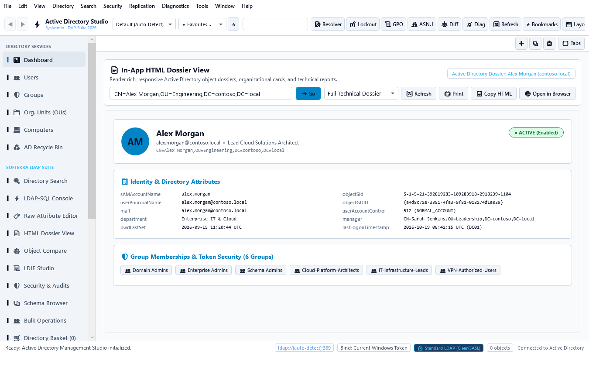 | Professional styled identity dossier featuring avatar badge, organizational hierarchy, key LDAP naming attributes (GUID, SID, UAC), pill group badges, and direct report rosters. |
| **Native Menu Bar & Omnibar Quick Search** | 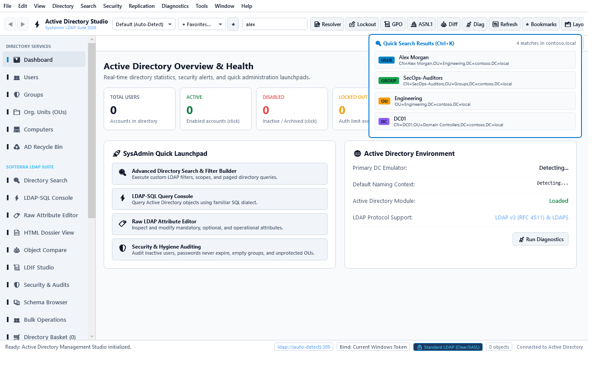 | Standard Windows horizontal menu bar with 11 top-level menus, live configuration checkmarks, keyboard accelerators, and a universal Omnibar popup (`Ctrl+K`) for rapid multi-type search across users, groups, OUs, and domain controllers. |

---

### Gallery 2: Enterprise Security, Access Control & Kerberos Suite

Forensic Active Directory security analysis including 6-way effective permissions evaluation, Kerberos PAC token bloat calculation, and 48 automated enterprise security hygiene audits.

| View / Component | Visual Showcase | Technical Highlights |
| :--- | :--- | :--- |
| **6-Way Effective Rights & ACL Security Suite** | 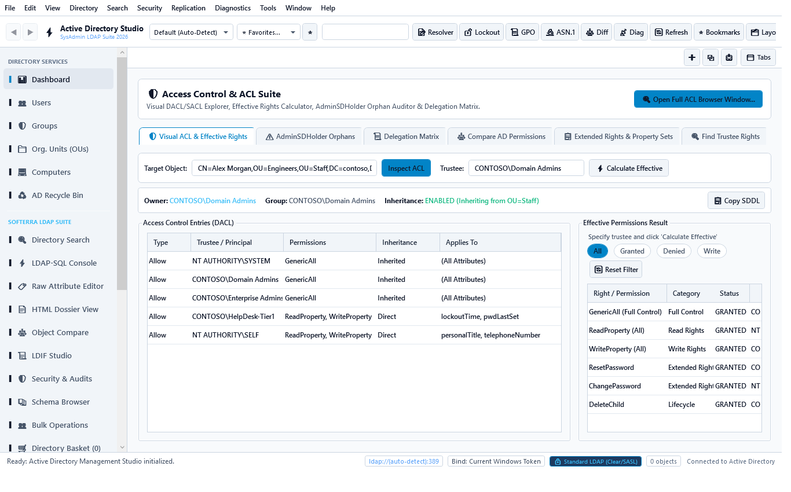 | Visual DACL/SACL explorer with raw SDDL syntax viewer, trustee assignment scanner, inheritance trace, and automated AdminSDHolder / `adminCount=1` orphan detection. |
| **Kerberos PAC Token Bloat Calculator** | 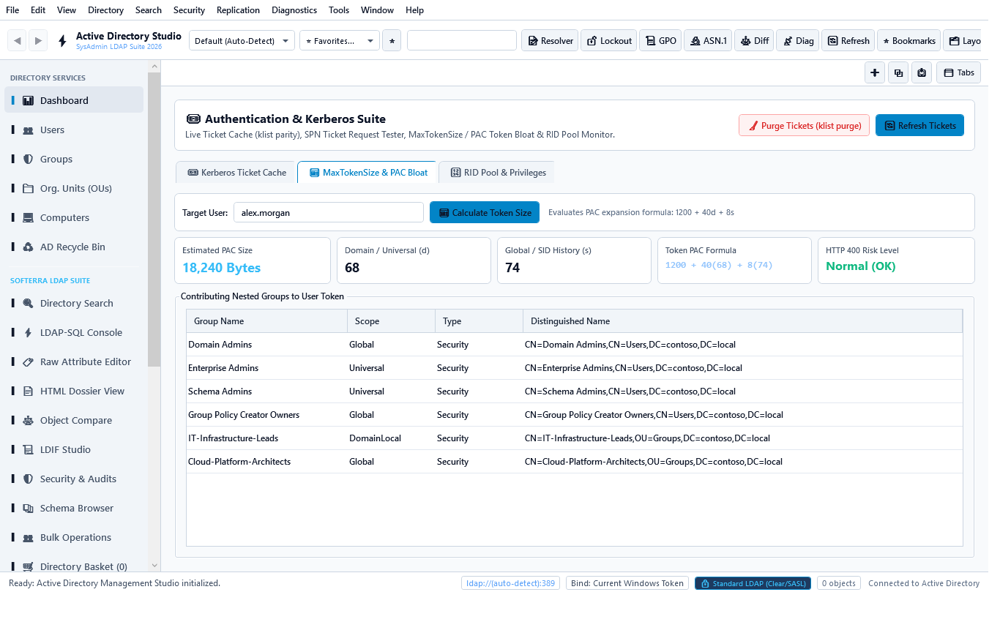 | Evaluates user token size against the RFC formula `1200 + 40d + 8s` to diagnose HTTP 400 Bad Request logon failures and recommend registry `MaxTokenSize` thresholds. |
| **48 Enterprise Security Audit Reports** | 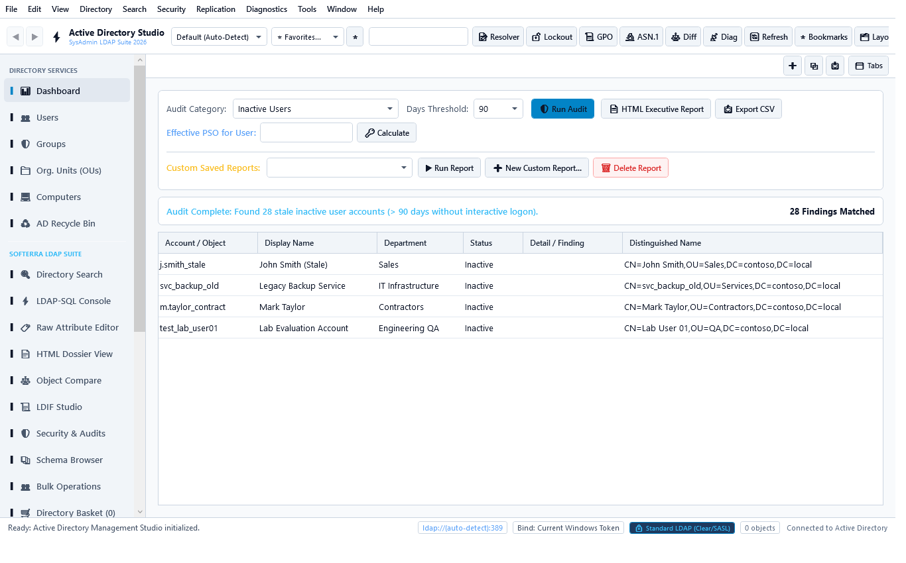 | Automated forensic audits categorized into User Accounts, Passwords, Security Groups, Computer Hygiene, and AdminSDHolder, with instant export to styled HTML executive reports. |

---

### Gallery 3: Advanced Directory Engines & Competitor Parity

Industry-grade tools matching and surpassing Softerra LDAP Administrator and Apache Directory Studio workflows, featuring ANSI-SQL directory querying, dual object diffing, and RFC 2849 LDIF safety models.

| View / Component | Visual Showcase | Technical Highlights |
| :--- | :--- | :--- |
| **Extended LDAP-SQL Query Console** | 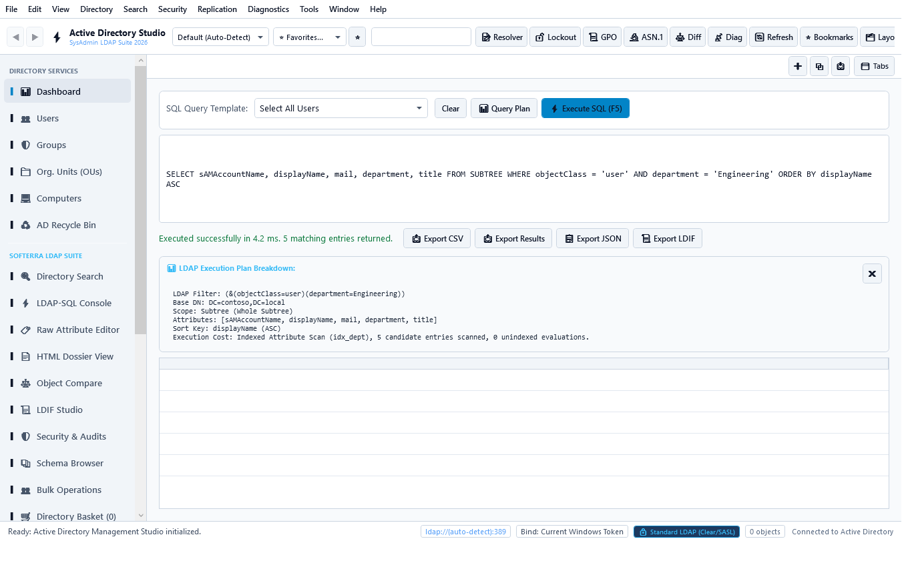 | Execute familiar ANSI-SQL queries (`SELECT ... FROM ... WHERE ...`) compiled into high-performance RFC 4515 LDAP search filters with execution plan breakdown, cost estimates, and CSV/JSON/LDIF export. |
| **Dual Object Compare & Drift Analyzer** | 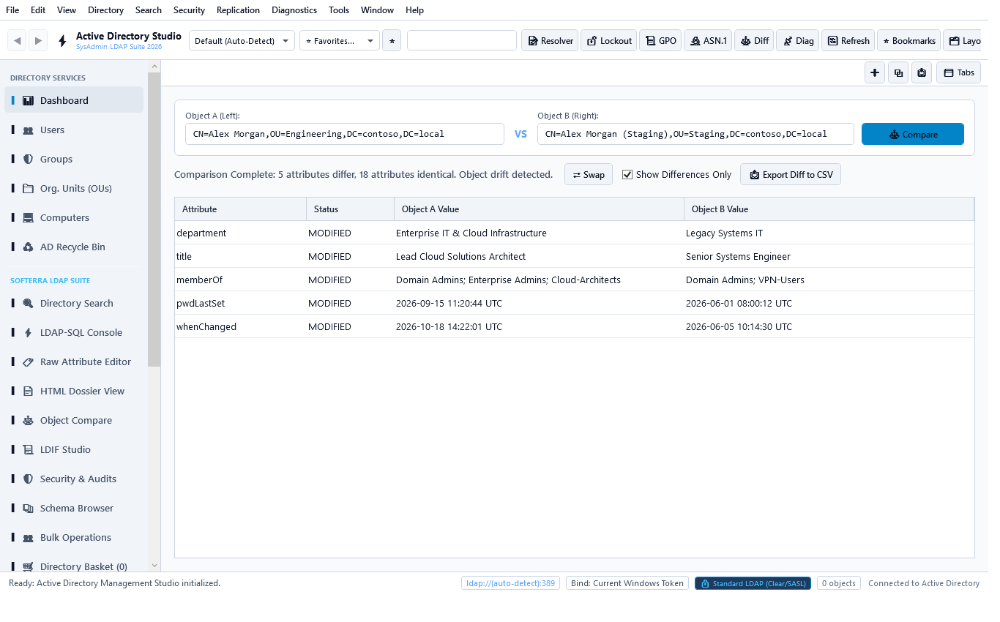 | Side-by-side attribute drift comparator between any two directory objects (or across DCs) with difference isolation, status badges (MODIFIED, IDENTICAL, MISSING), and CSV drift export. |
| **RFC 2849 LDIF Studio & Safety Engine** | 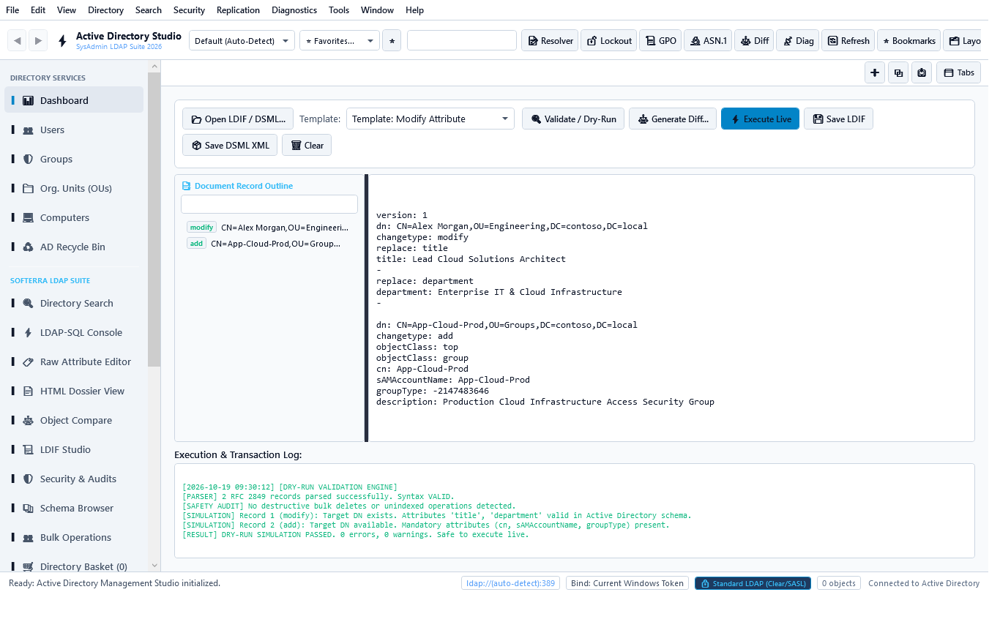 | Script editor with Document Record Outline tree, syntax validation, and a two-stage safety model requiring **Dry-Run Simulation** before executing batch mutations live against Active Directory. |
| **Wire Protocol Modification Logs & Rollback** | 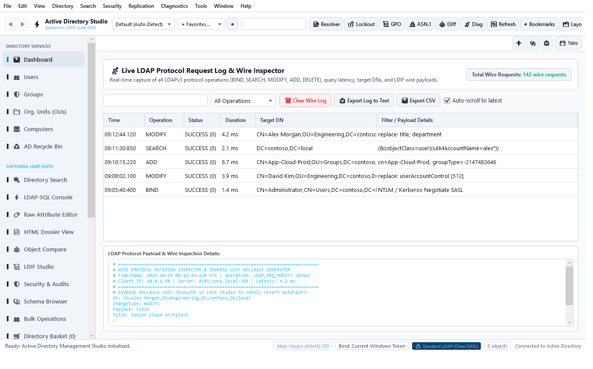 | Real-time audit stream capturing all LDAPv3 protocol operations (`BIND`, `SEARCH`, `MODIFY`, `ADD`, `DELETE`), latency tracking, and automatic generation of **Inverse LDIF Rollback Scripts** for safe mutation reversals. |

---

### Gallery 4: Low-Level Value Processors & Schema Architecture

Dedicated attribute value processors and schema inspection workbenches for specialized directory data formats.

| View / Component | Visual Showcase | Technical Highlights |
| :--- | :--- | :--- |
| **Specialized Hex & Binary Editor** | 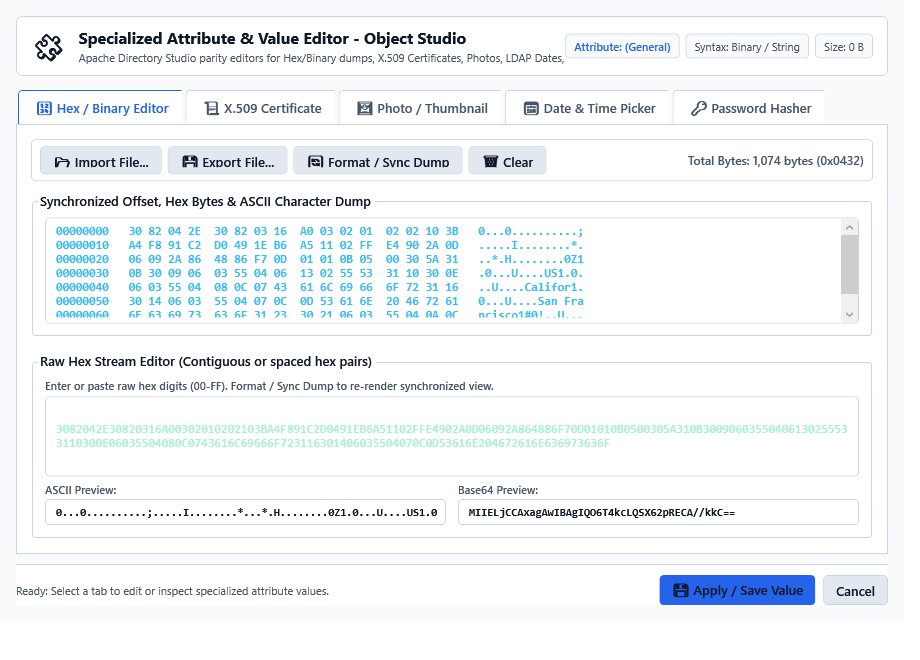 | Low-level hexadecimal dump viewer with 16-byte aligned offset grid, ASCII character translation, Base64 preview, and endian-aware GUID decoder for binary OctetString attributes. |
| **Specialized X.509 Certificate Viewer** | 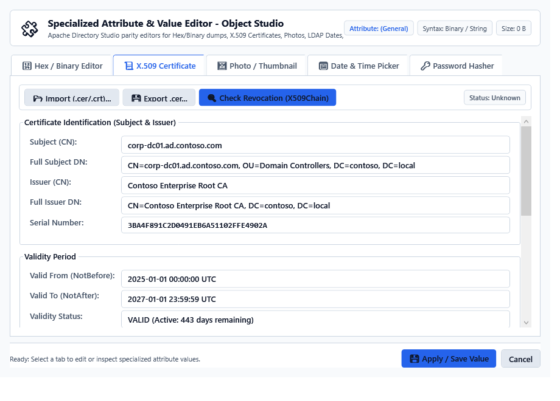 | Decodes DER-encoded X.509 digital certificates (`userCertificate`), inspecting Subject, Issuer, Serial Number, Validity, SHA-256 Thumbprint, SAN (UPN/DNS), Key Usage, and CRL/OCSP status. |
| **SCIM 2.0 Query & Filter Studio** | 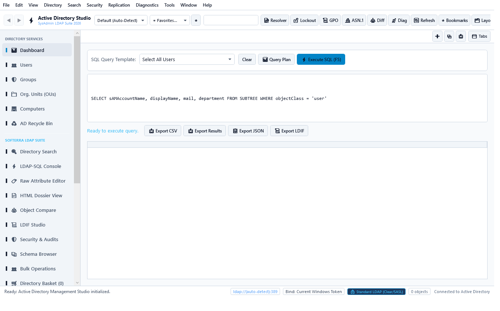 | Bidirectional filter compiler translating Cloud Identity SCIM 2.0 expressions (RFC 7644) into optimized RFC 4515 LDAP search filters and vice-versa, complete with execution benchmarking. |
| **Active Directory Schema Browser** | 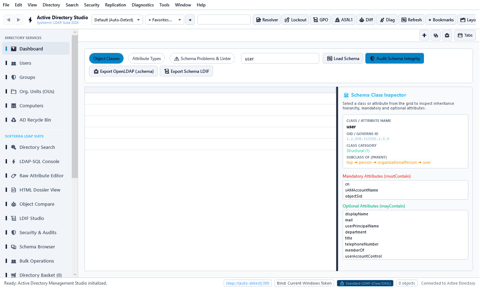 | Complete directory schema catalog with class inheritance graphs (`top ➔ person ➔ organizationalPerson ➔ user`), mandatory (`mustContain`) and optional (`mayContain`) attributes, and OpenLDAP `.schema` export. |

---

### Gallery 5: Infrastructure Health, Multi-DC Replication & Diagnostics

Comprehensive network and replication diagnostics matching NetTools capabilities for enterprise domain controller topologies.

| View / Component | Visual Showcase | Technical Highlights |
| :--- | :--- | :--- |
| **Group Nesting Cycle Detector** | 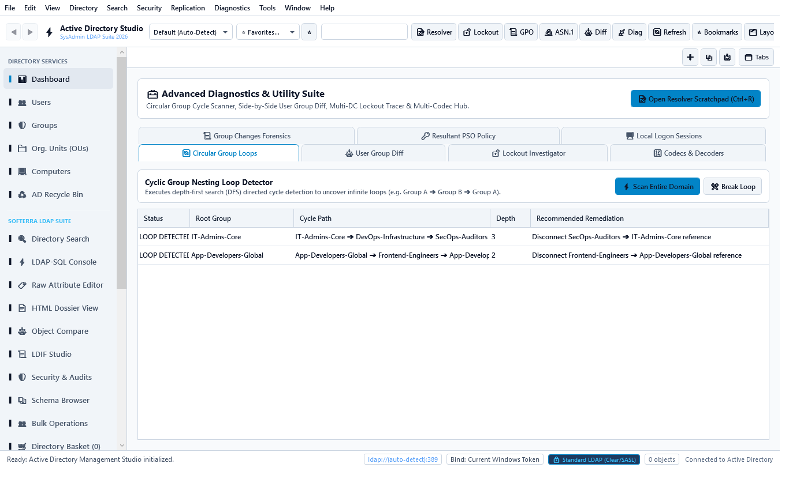 | Forensic Depth-First Search (DFS) graph analyzer identifying circular nested security group loops across the directory tree, with one-click automated loop breaking. |
| **NetTools 7-Tier Sequential UNC Verifier** | 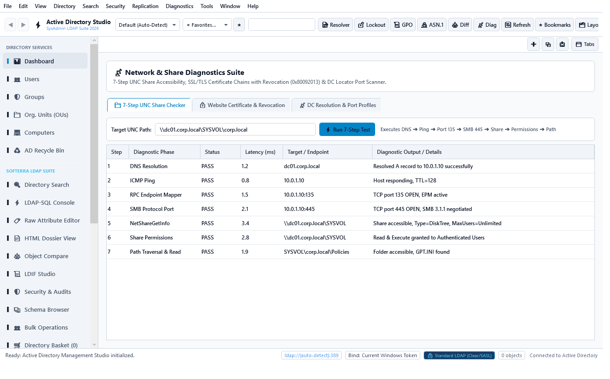 | Automated 7-step sequential network diagnostics: DNS Resolution ➔ ICMP Ping ➔ RPC EPM (TCP 135) ➔ SMB (TCP 445) ➔ NetShareGetInfo ➔ Share ACL Permissions ➔ Path Traversal & GPT.ini Read. |
| **Multi-DC Replication Suite & LastLogon Matrix** | 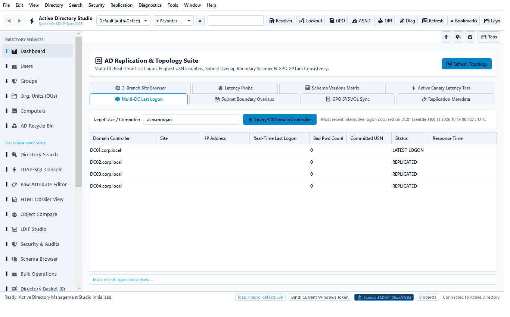 | Concurrent multi-DC interrogator querying non-replicated `lastLogon` timestamps, highest USN counters, subnet overlap boundaries, and replication partner convergence. |
| **Connection Profiles & Server Monitor** | 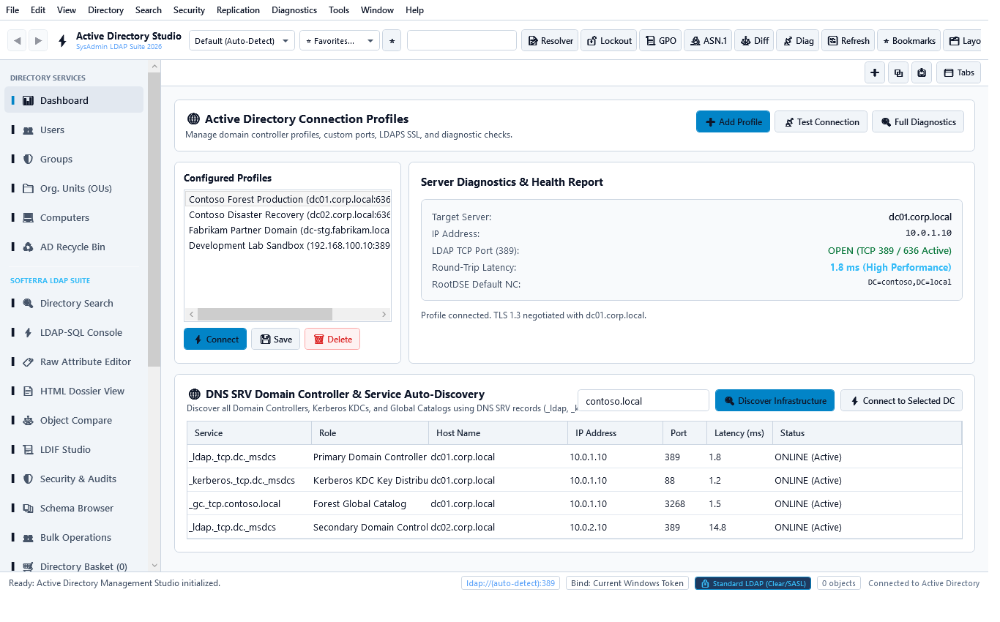 | Multi-forest profile manager supporting LDAPS SSL (port 636) and Global Catalog (port 3268), live TCP socket latency testing, RootDSE inspection, and DNS SRV auto-discovery. |

---

## 🎹 Native Horizontal Menu Bar & Ergonomics Reference

Active Directory Management Studio features a native Windows menu bar organized across 11 top-level categories. All settings, active themes, page sizes, and CSV delimiters maintain live checkmarks synchronized with the application state.

### Top-Level Menu Structure

| Menu | Submenu Highlights | Key Accelerators | Function & Operator Purpose |
| :--- | :--- | :--- | :--- |
| **File** | New Object (User, Group, OU, Computer, Contact), Connect Profile, Data Interchange (Export Subtree, Import LDIF, CSV, DSML), Print Dossier, Exit | `Ctrl+N`, `Ctrl+P`, `Ctrl+E`, `Ctrl+Shift+P`, `Alt+F4` | Primary lifecycle commands, connection switching, and directory data interchange. |
| **Edit** | Quick Search (Omnibar), Specialized Attribute Editor, Specialized Edit Value, Reset User Password, Toggle Enable/Disable, Delete Object, Clear Selection | `Ctrl+K`, `Ctrl+I`, `Ctrl+Shift+E`, `Ctrl+Shift+R`, `Delete` | Object property editing, credential resets, and omnibar search activation. |
| **View** | Active Theme (Light / Dark mode live checkmarks), Search Page Size (100, 250, 500, 1000 entries), Show Operational Attributes, Auto-Refresh Interval, Toggle Full Screen | `Ctrl+T`, `F11` | Visual theme customizer, DataGrid page density, and display preferences. |
| **Directory** | Users, Groups, Computers, Organizational Units, Recycle Bin & Tombstones, Raw Attribute Editor, In-App HTML Technical Dossier | `Ctrl+1`, `Ctrl+2`, `Ctrl+3`, `Ctrl+4`, `Ctrl+5` | Fast direct switching between core Active Directory object management views. |
| **Search** | Visual LDAP Search & SCIM Studio, Extended LDAP-SQL Console, Directory Staging Basket, Saved LDAP Searches & Bookmarks | `Ctrl+F`, `Ctrl+Q`, `Ctrl+B` | Query engines, visual filter building, and cross-OU staging cart. |
| **Security** | Access Control & ACL Suite, Kerberos PAC & Token Bloat Evaluator, 48 Enterprise Security Reports, AdminSDHolder Orphan Auditor | `Ctrl+Shift+A`, `Ctrl+Shift+K`, `Ctrl+Shift+U` | Authorization analysis, token sizing, and automated hygiene audits. |
| **Replication** | Multi-DC Last Logon Timeline, AD Replication Topology & USN, Subnet Overlaps & Boundaries, GPO GPT.ini Consistency Check | `Ctrl+Shift+M`, `Ctrl+Shift+T` | Multi-controller logon auditing, replication health, and boundary scanning. |
| **Diagnostics** | Circular Group Loop Detector, NetTools 7-Tier UNC Verifier, DC Port Latency Matrix, Resolver Scratchpad, Quick Lockout Investigator | `Ctrl+R`, `Ctrl+L` | Network and infrastructure troubleshooting, loop breaking, and entity resolution. |
| **Tools** | Active Directory Schema Browser, Bulk CSV Provisioning Wizard, Live Wire Protocol Request Log, LDIF Studio & Safety Simulator, Application Settings | `Ctrl+Shift+S`, `Ctrl+Shift+L`, `Ctrl+,` | System administration tools, schema inspection, and configuration. |
| **Window** | New Workspace Tab, Detach Current Workspace (Floating Window), Re-dock All Floating Windows, Close Active Tab, Cycle Forward/Backward | `Ctrl+Shift+T`, `Ctrl+Shift+D`, `Ctrl+Shift+W`, `Ctrl+Tab` | Multi-monitor management, floating windows, and in-process tabbed navigation. |
| **Help** | Keyboard Shortcuts Reference Guide, Open SysAdmin Handbook, Open Visual Walkthrough, Open GitHub Wiki, Online Documentation, About Studio | `F1` | Integrated documentation, keyboard shortcut cheat-sheet, and version info. |

### Global Keyboard Accelerators

```
  ┌────────────────────────────────────────────────────────────────────────┐
  │                        GLOBAL SHORTCUT CHEAT SHEET                     │
  ├────────────────────────────────┬───────────────────────────────────────┤
  │ Ctrl+K       Open Omnibar      │ Ctrl+1..5    Core Workspaces (Users..)│
  │ Ctrl+P       Connect Profile   │ Ctrl+F       Visual Directory Search  │
  │ Ctrl+N       New User Account  │ Ctrl+Q       LDAP-SQL Query Console   │
  │ Ctrl+E       Export Subtree    │ Ctrl+B       Directory Staging Basket │
  │ Ctrl+R       Resolver Notepad  │ Ctrl+T       Toggle Light/Dark Theme  │
  │ Ctrl+L       Lockout Inspector │ F5           Refresh / Execute Query  │
  │ Ctrl+Shift+D Detach Workspace  │ F11          Toggle Full Screen       │
  └────────────────────────────────┴───────────────────────────────────────┘
```

---

## 🚀 Quick Start

### Prerequisites
- **Operating System**: Windows Server 2016 / 2019 / 2022 / 2025 or Windows 10 / 11
- **PowerShell**: Windows PowerShell 5.1 or PowerShell 7.2+
- **Connectivity**: Network connectivity to an Active Directory Domain Controller (port 389 LDAP or 636 LDAPS)
- **Permissions**: Domain User permissions for read operations; Domain Admin / Delegated OU permissions for modifications

### Launching the Graphical Studio
```powershell
# Clone repository
git clone git@github.com:catmuf/ad-management-studio.git
cd ad-management-studio

# Launch Active Directory Management Studio
.\main.ps1
```

### Headless Automation CLI (`tools/ad-studio-cli.ps1`)
The included automation CLI enables unattended administration, scheduled security audits, batch LDIF execution, and LDAP-SQL exports in CI/CD pipelines:

```powershell
# Run all 48 security hygiene audits and export an executive HTML report
.\tools\ad-studio-cli.ps1 -Audit -Category All -OutReport "reports/audit-2026.html"

# Execute an LDAP-SQL query and export results to CSV
.\tools\ad-studio-cli.ps1 -QuerySql "SELECT sAMAccountName, mail, department FROM SUBTREE WHERE objectClass = 'user'" -OutCsv "users.csv"

# Validate and execute an LDIF script in Dry-Run simulation mode
.\tools\ad-studio-cli.ps1 -LdifPath "scripts/update_departments.ldif" -DryRun

# Perform a 7-tier sequential UNC share diagnostic
.\tools\ad-studio-cli.ps1 -TestUnc "\\dc01.corp.local\SYSVOL\corp.local"
```

---

## 📁 Repository Architecture

```
ad-management-studio/
├── main.ps1                           # Application entrypoint & STA launcher
├── config.json                        # Configuration persistence & connection profiles
├── HANDBOOK.md                        # SysAdmin Handbook & Technical Reference
├── WALKTHROUGH.md                     # Visual Operator Walkthrough (10 Scenarios)
├── README.md                          # Repository showcase & documentation
├── docs/
│   └── images/                        # 19 High-resolution Light theme application screenshots
│       ├── 01_dashboard_overview.png
│       ├── 02_users_and_inspector.png
│       ├── 03_specialized_editor_hex.png
│       ├── 04_specialized_editor_cert.png
│       ├── 05_scim_filter_studio.png
│       ├── 06_security_acl_6way.png
│       ├── 07_kerberos_token_bloat.png
│       ├── 08_circular_groups_loop.png
│       ├── 09_audit_reports_48.png
│       ├── 10_network_7tier_unc.png
│       ├── 11_native_menu_and_omnibar.png
│       ├── 12_html_dossier_technical.png
│       ├── 13_ldap_sql_console.png
│       ├── 14_object_compare_diff.png
│       ├── 15_replication_and_dc_matrix.png
│       ├── 16_ldif_studio_and_safety.png
│       ├── 17_schema_class_browser.png
│       ├── 18_modification_logs_rollback.png
│       └── 19_connection_profiles_manager.png
├── tools/
│   ├── ad-studio-cli.ps1              # Unattended automation CLI engine
│   ├── Capture-AppScreenshots.ps1     # Automated WPF Light theme screen capture engine
│   ├── test-core-operations.ps1       # Comprehensive GUI test harness (Panels 1-12)
│   ├── test-advanced-diagnostics.ps1  # Advanced diagnostics test harness (Panels 13-24)
│   └── test-all-workspaces.ps1        # Full regression validation harness
├── Modules/
│   ├── ADService.psm1                 # LDAP engine, RSAT/ADSI bridge, SQL, LDIF, 48 Audits
│   ├── AclService.psm1                # 6-Way Effective Rights, DACL/SACL, AdminSDHolder
│   ├── KerberosService.psm1           # PAC Bloat formula, MaxTokenSize, ticket cache
│   ├── DiagnosticService.psm1         # DFS circular group loop detector, lockout tracer
│   ├── NetworkService.psm1            # 7-Tier UNC share verifier, 8-port DC latency matrix
│   ├── ReplicationService.psm1        # Multi-DC non-replicated lastLogon & USN counters
│   ├── ScimFilterService.psm1         # Bidirectional RFC 7644 SCIM <-> RFC 4515 LDAP compiler
│   ├── ScimService.psm1               # SCIM 2.0 Core/Enterprise schema models and bulk processing
│   ├── SpecializedEditorService.psm1  # Hex/Binary dump, X.509 certs, photo cropping, date/hash
│   ├── TemplateService.psm1           # Provisioning templates, macro expansions, collision handling
│   ├── ValidationService.psm1         # UAC bitmask, LargeInteger, GUID, SID, filter validation
│   ├── ExportService.psm1             # CSV, JSON, LDIF, and HTML Executive Report exporter
│   ├── ConfigService.psm1             # Settings persistence, Profiles, and RootDSE discovery
│   ├── GpoService.psm1                # GPO SYSVOL consistency and versioning checker
│   └── LoggingService.psm1            # ISO 8601 millisecond logger (logs/YYYY-MM-DD.log)
├── Views/
│   ├── MainWindow.xaml                # Central workspace (24 views, native menu, Omnibar)
│   ├── SpecializedEditorDialog.xaml   # Hex dump, X.509 CRL/OCSP cert, photo, timestamp, hasher
│   ├── AclBrowserDialog.xaml          # Advanced ACL browser and 6-Way Effective Rights modal
│   ├── GpoExplorerDialog.xaml         # GPO consistency and policy explorer modal
│   ├── AttributeEditDialog.xaml       # Multi-mode attribute editor
│   ├── ColumnChooserDialog.xaml       # DataGrid dynamic column customizer modal
│   ├── ConnectionDialog.xaml          # Connection profile modal with live TCP diagnostics
│   ├── UserDialog.xaml                # User provisioning and modification modal
│   ├── UserDetailDialog.xaml          # User inspection and group membership viewer
│   ├── PasswordDialog.xaml            # Password reset and generator modal
│   ├── GroupDialog.xaml               # Group creation and settings modal
│   ├── MemberDialog.xaml              # Group membership manager modal
│   ├── OUDialog.xaml                  # Organizational Unit creation modal
│   └── MoveDialog.xaml                # Object OU mover modal
└── tests/                             # Automated Pester/PowerShell test suites (265+ assertions)
```

---

## 🛡️ Security, Privacy & Compliance

- **Authentication**: Uses Windows Single Sign-On (Kerberos / NTLM Negotiate SASL). No credentials, passwords, or tokens are ever stored in plaintext or logged to disk.
- **Privacy**: Operates entirely in your local on-premises network. Zero telemetry, zero analytics tracking, and zero cloud outbound transmissions.
- **Safety First**: Destructive batch updates require explicit confirmation. The LDIF Studio enforces a Dry-Run simulation model, and every directory mutation produces an automatic Inverse LDIF Rollback script in the Request Log.
- **Attribution & Respect**: Architectural inspirations from **Softerra LDAP Administrator**, **Apache Directory Studio**, and **NetTools** are acknowledged with gratitude. All rights and trademarks belong to their respective creators.

---

## 📄 License

This project is licensed under the [MIT License](LICENSE).
